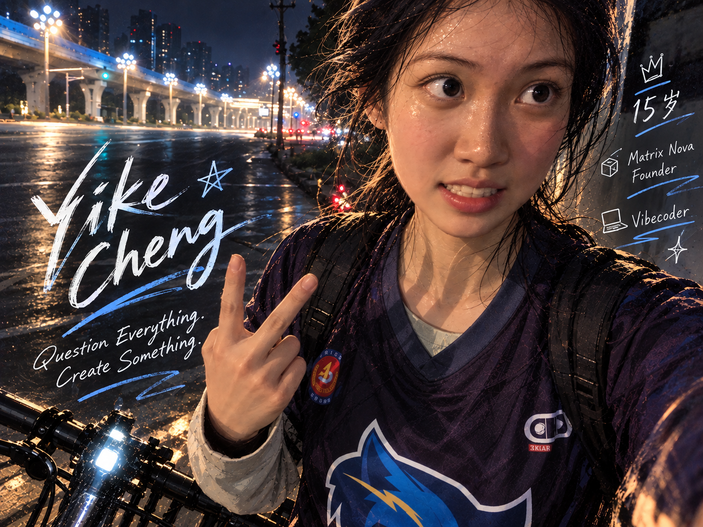

  

<h1 align="center">Yike Cheng</h1>

  <strong>Stay curious. Make it real.</strong> 
  Student developer · Matrix Nova founder · AI &amp; mathematical modeling

---

## A little about me

I'm a student developer who enjoys asking questions and building things to find the answers. My interests sit between **AI, mathematical modeling, and useful software**.

At **Matrix Nova**, I help bring young people together to learn, create, and share through our Learnathon (学客松). I care about making ideas tangible—and helping other people do the same.

## What I work with

**AI & modeling** — agent workflows, quantitative problems, and reproducible experiments. 
**Web & product** — interactive interfaces, data tools, and small applications with a clear purpose.

`Python` · `TypeScript` · `React / Next.js` · `SQL` · `LaTeX`

## A few things I've built

| Project | In a sentence |
| :--- | :--- |
| [MathModel Run ↗](https://github.com/chengyike20110519-create/MathModelRun) | A workflow connecting mathematical models, experiments, and verifiable results. |
| [PathOS ↗](https://github.com/chengyike20110519-create/pathos-V2) | A collaborative research preview for exploring universities through maps and data. |

  <a href="https://github.com/chengyike20110519-create?tab=repositories">More of my work ↗</a>

