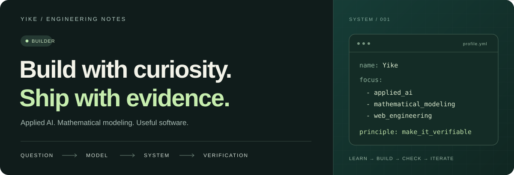
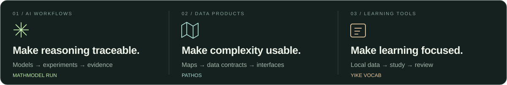

  

  

  <a href="#selected-work">Selected work</a> &nbsp; / &nbsp;
  <a href="#technical-toolkit">Technical toolkit</a> &nbsp; / &nbsp;
  <a href="#how-i-build">How I build</a> &nbsp; / &nbsp;
  <a href="https://github.com/chengyike20110519-create?tab=repositories">All repositories ↗</a>

## A little about me

I'm **Yike Cheng**, a student developer and **Matrix Nova founder**, working across **applied AI, mathematical modeling, and web engineering**. I like turning questions into working projects—from reproducible modeling workflows to interactive data products and tools for learning.

At **Matrix Nova**, I help bring young people together to learn, build, and share what they create. Our Learnathon (学客松) is about making your own ideas real while connecting with other builders.

I move between research and product: build the model, run the experiment, design the interface, and check what actually works. MathModel Run, PathOS, and Yike Vocab are three ways I put that into practice.

**Question everything. Create something.**

  

## Selected work

### 01 / MathModel Run

**An evidence-driven execution system for mathematical modeling.**

A workflow for CUMCM, MCM/ICM, HiMCM, and similar competitions: take a problem through model selection, validation, reproducible experiments, frozen results, paper writing, rendering, and audit.

- **Architecture:** a ten-stage state machine with explicit evidence gates.
- **Traceability:** connect claims and frozen numbers to their source runs.
- **Agent integration:** reusable skills for Codex and Claude Code, including paper iteration.

`Python` · `Agent workflows` · `Mathematical modeling` · `Reproducibility`

[Explore MathModel Run ↗](https://github.com/chengyike20110519-create/MathModelRun)

---

### 02 / PathOS

**A map-based data product for exploring U.S. universities.**

A collaborative project bringing interactive maps, university profiles, regional indicators, and exploration tools into one interface. The current release is a **research preview**, with explicit source, missing-data, and verification boundaries.

- **Interface:** Next.js App Router, React, TypeScript, and MapLibre.
- **Data layer:** a Next.js BFF reads a local preview bundle with traceable sources.
- **Engineering focus:** keep the data contract, geographic interaction, and UI state consistent.

`TypeScript` · `Next.js` · `React` · `MapLibre` · `Data contracts`

[Explore PathOS ↗](https://github.com/chengyike20110519-create/pathos-V2)

---

### 03 / Yike Vocab · 亦可速记

**A local-first vocabulary learning application.**

A focused study tool that keeps vocabulary, progress, and review history on the user's own computer. It combines a central flashcard with a collapsible unit list, making it easy to move between individual words and the bigger picture.

- **Workflow:** import wordbooks, study with keyboard shortcuts, and review by learning status.
- **Persistence:** SQLite for learning records and local browser storage for session state.
- **Document support:** import common file formats and export practice PDFs.

`Python` · `SQLite` · `JavaScript` · `HTML / CSS` · `PDF processing`

[Explore Yike Vocab ↗](https://github.com/chengyike20110519-create/Yike-Vocab)

## Technical toolkit

| Area | Tools & concepts I use |
| :--- | :--- |
| **Languages** | Python · TypeScript · JavaScript · SQL |
| **Web engineering** | Next.js · React · HTML / CSS · Tailwind CSS |
| **Data & interfaces** | SQLite · PostgreSQL · MapLibre · data contracts |
| **AI & modeling** | Agent workflows · model validation · reproducible experiments |
| **Verification** | Vitest · Playwright · evidence tracking · rendered-document review |
| **Research output** | LaTeX · PDF generation · scientific figures |

## How I build

**01 — Start with the question.** Define the problem and the evidence a useful answer would need.

**02 — Make a working baseline.** Build a small end-to-end version before adding complexity.

**03 — Keep the result inspectable.** Track sources, preserve missing values, and distinguish a preview from a validated result.

**04 — Finish the interface.** Make the system understandable to the person using it, then check the actual output.

## What I'm exploring

- **Reliable AI workflows:** helping agents produce results that can be checked and reproduced.
- **Modeling as software:** turning a quantitative method into a usable, maintainable tool.
- **Interfaces for complex information:** maps, research tools, and focused learning experiences.

---

  <strong>Curious about the problem. Serious about the implementation.</strong> 
  Building, learning, and improving through real projects.

